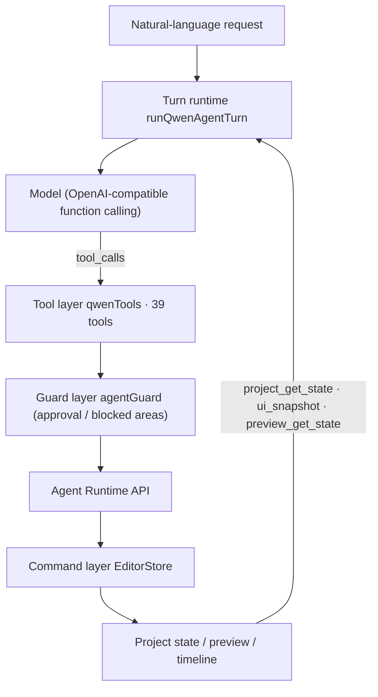
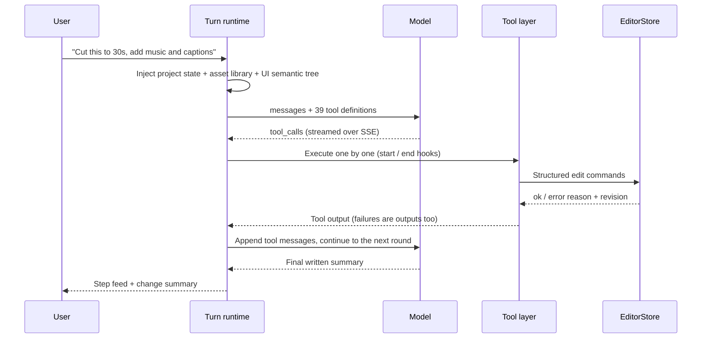
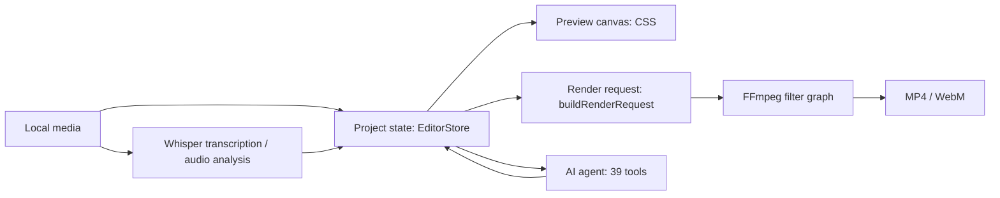

<div align="center">

# ximo-Cut

**A Windows desktop video editor · precise manual cutting + AI-driven editing · what you preview is what you export**

[简体中文](README.md) | English


</div>

## Overview

ximo-Cut is a local-first video editor for Windows built for individual creators. It works like a regular NLE when you want frame-accurate manual editing, and it lets an AI agent operate the timeline directly when you'd rather describe the result in natural language.

Three principles shape the app:

- **Manual editing stays precise** — multi-track timeline, frame stepping, keyframe curves, custom speed ramps, clip grouping, undo/redo.
- **AI actually edits** — the model calls structured tools that mutate the project; risky actions require confirmation, and failures are reported instead of silently ignored.
- **Preview equals export** — the preview canvas and the FFmpeg render share the same project parameters (transform, filters, text style, transitions, volume), so you don't need to export just to check the result.

All media, drafts and renders stay on your machine. Only AI chat requests send a project summary and, when needed, the current frame to the model endpoint you configure.

## At a glance

| Capability | Details |
| --- | --- |
| 39 AI tools | Reading, editing, properties, audio, generation, review, export and UI control; up to 8 consecutive tool rounds per request |
| Plan first | Shot plans are shown as cards and written to the timeline only after approval; delete, export and quick cut require a second confirmation |
| Real project validation | Every AI action goes through the editor command layer and obeys overlap, lock and track-type rules, and stays undoable |
| Three-layer video compositing | The preview renders every visible video track in export order, not just the top one |
| One source of truth | The same parameters drive the CSS preview and the FFmpeg graph, so font size, stroke, position and volume ratios match |
| Local speech pipeline | whisper.cpp transcription plus Windows SAPI voice-over, with generated audio persisted locally |
| Batch and review | Batch export with multiple parameter sets, followed by an automatic quality review and issue list |

## Main features

### 1. Timeline editing

- Multiple video, audio and text tracks; mute, hide, lock, reorder and resize tracks.
- Clip operations: drag, trim both edges, split at the playhead, delete, ripple delete.
- Frame stepping (`←` / `→`), one-second jumps (`Shift` + arrows), snapping and zoom.
- Multi-select (`Ctrl`+click), group / ungroup, copy / cut / paste.
- Timeline markers: add, jump to, delete.
- Clip thumbnails, real audio waveforms, accurate durations and end-trim limits.
- Full undo/redo; consecutive slider drags are coalesced into one step within a time window.

### 2. Picture and color

- Transform: position (canvas percentage), scale, rotation, opacity — all keyframeable.
- Transitions: fade through black, white flash, fade through white, with several durations; the preview uses the same color and timing.
- Masks: rectangular, elliptical and linear, with feathering and inversion.
- Blend modes: normal, multiply, screen, overlay, soft-light, darken, lighten.
- 120 built-in filters, 92 effects (including a Jianying-style set) and 14 color adjustments: brightness, contrast, saturation, exposure, temperature, tint, hue, highlights, shadows, vibrance, sharpen, grain, vignette and fade.
- Automatic pad/crop after rotation or scaling, so no empty corners appear.
- Denoise switch that maps to the matching FFmpeg filter on export.

### 3. Keyframes and speed

- Keyframes for position / scale / rotation / opacity, with add, remove, seek and a curve graph.
- Constant speed, plus slow-motion, fast and bullet-time three-segment ramps.
- Custom speed ramp: given a peak speed and position, a five-segment curve is generated (1 → √peak → peak → √peak → 1).
- Trimming, export source-time offsets and keyframe times are all recalculated, so preview and export never drift apart.

### 4. Text and subtitles

- Stacked text layers with three roles — title, caption, sticker — each with its own export policy.
- Font size, color, weight, stroke, stroke color, background box, alignment, top/center/bottom position and three entrance animations (fade, slide up, none).
- 66 text presets and 176 stickers.
- Long text wraps at 82% of the frame width, matching the export font scale.
- SRT import; local Whisper transcription; the "burn subtitles" switch only affects captions — titles and stickers are always exported.

### 5. Audio

- Multi-track mixing with per-clip gain (dB), fades, mute and track-level mute.
- Real waveforms; audio analysis includes peak, RMS, estimated LUFS, silence ranges, BPM and beat points, with trim suggestions for silent parts.
- Extract audio from video, microphone recording, 3 built-in royalty-free tracks and 6 built-in SFX.
- Windows SAPI text-to-speech, saved to a persistent local directory.
- Automatic ducking, noise reduction and loudness normalization.
- Audio embedded in video clips plays with the picture, so no hidden audio layers are needed.

### 6. AI editing

- Natural language for cutting, rough cuts, transitions, color, captions, music, voice-over, SFX and export.
- Quick cut: given a target duration, it selects footage, rebuilds the main video track, adds music and captions.
- Story planning: builds a narrative structure (opening / development / climax / ending) and shot rhythm from a style and target duration.
- Footage analysis: scores sharpness, exposure, motion and usability per shot and only picks good takes.
- Timeline review: scores the timeline or an exported file and lists issues (pacing, loudness, color cast, text, black frames).
- Reference replication: extracts keyframes from a reference video and asks a vision model to analyze shot sizes, camera moves and rhythm, producing an editable script.

### 7. Preview

- Shared parameters with export; three or more video tracks are composited in export order.
- The player shows real buffered progress (reads `video.buffered` and maps it back to the timeline).
- Adjustable preview volume, safe-area overlay and caption toggle.
- Transition colors, masks, blend modes, filters and effects are visible in real time.
- Images, vertical projects and text-only projects can all be previewed.

### 8. Export

- MP4 (H.264 + AAC) or WebM (VP9 + Opus).
- 1920×1080, 1080×1920 (vertical) or 1280×720.
- 24 / 25 / 30 / 60 fps and 6 / 8 / 12 / 20 Mbps.
- Export a timeline range, auto-review the result, or submit several parameter sets as a batch.
- Text-only projects can be rendered as well.

### 9. Projects and drafts

- Home screen draft library with auto-save, cover thumbnails, rename, duplicate and delete.
- Project import/export (`.ocproj` / `.json`) carrying media paths, render settings and audio analyses.
- Script library that turns a script into shots and a finished cut.
- Settings for the AI model, export defaults, timeline, preview and storage; the API key never leaves your machine.

## Agent architecture

### Design goal

Most "AI editing" stops at chat: the model suggests, the user edits. ximo-Cut's agent edits the project itself, which means it has to solve four problems at once: **understand the context, change the right thing, stay within bounds, and stay undoable**.

### Layers



- **Turn runtime** assembles context, streams the reply, executes tools in order and feeds results back to the model, for up to 8 rounds.
- **Tool layer** only normalizes arguments and dispatches; it never changes state directly.
- **Command layer** (`EditorStore`) validates everything: track type, overlap, lock state, trim bounds, keyframe ranges. AI edits and manual edits take the same path, so undo, redo and saving behave identically.
- **Guard layer** decides which tools need human approval and which parts of the UI the agent may not touch.

### Lifecycle of one request



### The 39 tools

| Category | Tools | Count |
| --- | --- | --- |
| Reading and context | `project_get_state`, `ui_snapshot`, `preview_get_state`, `audio_get_analysis` | 4 |
| Timeline and clips | `timeline_drag_clip`, `timeline_trim_clip`, `timeline_split_clip`, `timeline_delete_clip`, `timeline_add_track`, `clip_set_transition`, `clip_set_mask`, `clip_set_blend` | 8 |
| Clip properties | `clip_set_transform`, `clip_set_volume`, `clip_set_speed`, `clip_set_adjust`, `clip_set_text_style`, `keyframe_add`, `keyframe_remove`, `speed_ramp` | 8 |
| Audio and speech | `sfx_list`, `sfx_insert`, `voiceover`, `caption_transcribe` | 4 |
| Generation | `plan_propose`, `plan_story`, `analyze_footage`, `quick_cut` | 4 |
| Review | `review_timeline`, `review_video` | 2 |
| Export | `render_get_settings`, `render_update_settings`, `render_start`, `render_batch` | 4 |
| Preview and UI | `preview_seek`, `preview_play`, `preview_pause`, `ui_click`, `ui_set_value` | 5 |

### What makes it different

**1. Grounding on every round**

Each user message carries the full project snapshot, the asset library, the selected clip, the playhead position and the UI semantic tree. The model never has to guess who "this clip" is — the system prompt requires it to call `preview_get_state` and use the returned `selectedClipId` and `playhead`.

**2. Semantic IDs instead of screen coordinates**

Every interactive control carries `data-agent-id`. Clicking and setting values pass IDs rather than coordinates, so window size, zoom and theme changes do not affect reliability.

**3. Plans before writes**

`plan_propose` renders a shot list as cards (asset, duration, in-point, shot size, transition) and only converts it into clips after the user approves. `plan_story` proposes the narrative structure and rhythm in one go instead of letting the model improvise edit by edit.

**4. A dedicated confirmation channel for sensitive actions**

`timeline_delete_clip`, `render_start`, `render_batch` and `quick_cut` raise a confirmation bar describing the exact action (for example "delete clip clip-3 (ripple)"). A separate block list keeps window controls, settings, file import, recording, draft management and returning home in the user's hands.

**5. Failures are results, not exceptions**

Tool errors are captured as `{ ok: false, message }` and fed back to the model, which can retry with a different approach. If a run fails or the model stops responding, the run is marked as failed instead of leaving a half-edited project. The tool layer also rejects empty arguments (e.g. it will not silently insert the first SFX when no ID was given).

**6. Undo is guaranteed by the command layer**

Every AI step ends up as an `EditorStore` command with a revision and an undo entry. An AI run can be rolled back step by step like manual edits, without reloading the project.

**7. Observability and self-checks**

- `onToolStart` / `onToolEnd` surface each tool in the chat feed with elapsed time and output.
- `ui_snapshot()` returns the UI semantic tree; `audit()` counts interactive elements that still lack a `data-agent-id`; `selfTest()` runs the core commands against a fixture project and returns a pass/fail list.
- Together these turn "can the AI operate this UI?" into a measurable question.

**8. Adding a tool takes three steps**

1. Add the function definition (name, description, JSON Schema) in `qwenAgent.ts`.
2. Map the arguments to an edit command or runtime call in the `qwenTools.ts` switch.
3. Add approval or block rules in `agentGuard.ts` if the tool is sensitive.

The conversation loop, message rendering and undo system require no changes.

## Keyboard shortcuts

| Shortcut | Action |
| --- | --- |
| `Space` | Play / pause |
| `←` / `→` | Step one frame back / forward |
| `Shift` + `←` / `→` | Seek one second back / forward |
| `Delete` / `Backspace` | Delete selected clips |
| `Shift` + `Delete` | Ripple delete |
| `Ctrl` + `B` | Split selected clip at the playhead |
| `Ctrl` + `Z` / `Ctrl` + `Shift` + `Z` | Undo / redo |
| `Ctrl` + `C` / `X` / `V` | Copy / cut / paste |
| `Ctrl` + `S` / `Ctrl` + `Shift` + `S` | Save / save as |
| `Ctrl` + `O` / `Ctrl` + `N` | Open / new project |
| `Ctrl` + `E` | Export |
| `Ctrl` + `F` | Focus asset search |
| `Ctrl` + `K` | Command palette |
| `Ctrl` + `,` | Open settings |

## Architecture



| Layer | Technology |
| --- | --- |
| UI | React 19, TypeScript, Vite 8, TanStack Router |
| Desktop shell | Tauri 2, Rust (2021 edition), WebView2 |
| Rendering | FFmpeg (trim → setpts → rotate/scale/crop → fps → eq/colorbalance → fade → geq alpha → overlay/blend → drawtext) |
| AI | Qwen / DashScope OpenAI-compatible API with function calling (39 tools) |
| Speech | whisper.cpp (local transcription), Windows SAPI (TTS) |
| Cloud (optional) | Cloudflare Workers + Elysia proxy (`apps/api`) |

## Repository layout

```text
ximo-Cut/
├─ apps/
│  ├─ web/                 Main React application
│  │  ├─ desktop/          Desktop entry used by Tauri
│  │  ├─ src/features/     Editor, AI panel, asset library, inspector, timeline
│  │  └─ src-tauri/        Rust backend: render, ASR, TTS, drafts, thumbnails, review
│  ├─ api/                 Optional cloud AI proxy (Cloudflare Worker + Elysia)
│  └─ desktop/             GPUI native shell prototype (early experiment, not shipped)
├─ crates/media/setup/     FFmpeg asset setup script
├─ release/                Windows executable and bundled resources
└─ brand/                  Brand assets
```

## Requirements

- Windows 10 / 11 (x64) with the WebView2 runtime
- Node.js 20+ and npm
- Rust 1.97 (pinned in `.prototools`, install with `proto use`)
- FFmpeg: `ffmpeg` on `PATH`, or a full path in the `XIMOCUT_FFMPEG` environment variable

## Build and run

```bash
cd apps/web
npm install

# Web UI development (browser preview; importing files and rendering need the desktop app)
npm run dev

# Desktop development (Tauri window)
npm run desktop:dev

# Build the Windows executable
npm run desktop:build
# Output: apps/web/src-tauri/target/release/ximo-cut.exe
```

When distributing, place `release/resources` (`asr`, `music`, `sfx`) next to the executable so transcription and the built-in music/SFX libraries are available.

## Runtime resources and data locations

| Content | Location |
| --- | --- |
| Drafts / scripts / voice-over / thumbnails / reference frames / extracted audio | `%LOCALAPPDATA%\ximo-Cut\` |
| App settings (including the API key) | WebView2 local storage (this machine only) |
| Bundled Whisper model, music and SFX | `resources\` next to the executable |

> When upgrading from an older build, the first launch automatically moves `%LOCALAPPDATA%\OpenCut` and the previous WebView2 profile directory to the new names, keeping drafts, scripts, voice-over files and settings.

> The repository does not include `resources/asr/ggml-base-q5_1.bin` (a ~57MB Whisper model). Drop the model into that folder to enable local transcription; everything else works without it.

## Tests

```bash
cd apps/web
npx tsc --noEmit     # type check
npm test             # frontend unit tests (21 files, 133 tests)
cd src-tauri
cargo test --lib     # Rust unit tests
```

## Known limitations

- Windows builds only; text-to-speech relies on Windows SAPI.
- AI editing requires your own OpenAI-compatible API key. Manual editing works without one.
- Local transcription needs the Whisper model files under `resources/asr`.
- Clips reference source files by path, so moving or deleting them breaks preview and export.
- `apps/api` and `apps/desktop` are optional/experimental and are not required by the released app.

## License and acknowledgements

Released under the [MIT](LICENSE) license.

The UI and project structure continue the open-source [OpenCut](https://github.com/opencut-app/opencut) project (MIT). The desktop rendering pipeline, AI editing features and Chinese-language workflow were rebuilt on top of it. Thanks to the OpenCut authors and contributors.
