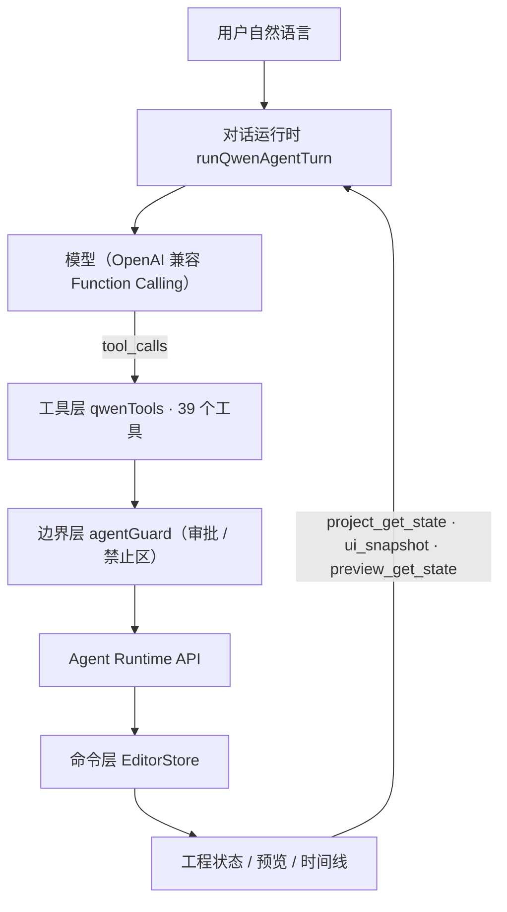
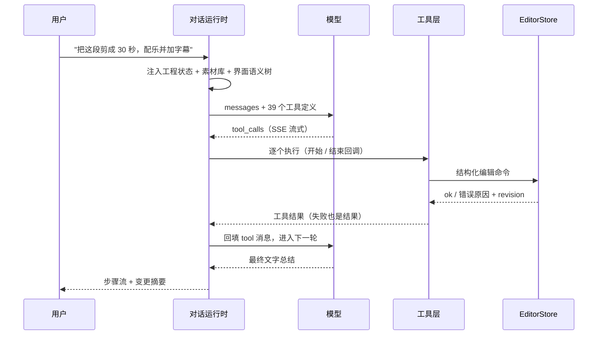
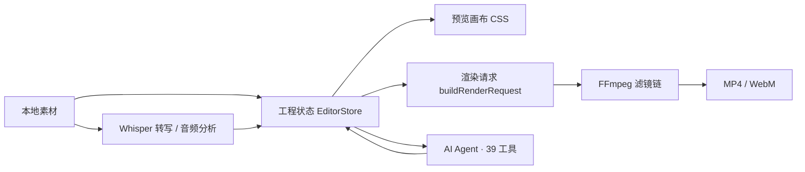

<div align="center">

# ximo-Cut

**Windows 桌面视频剪辑器 · 手动精剪 + AI 自动剪辑 · 预览与导出同源**

[简体中文](README.md) | [English](README.en.md)


</div>

## 简介

ximo-Cut 是一个运行在 Windows 上的本地视频剪辑工具，面向个人创作者：既能像常规非编软件一样手动逐帧精剪，也能用自然语言让 AI 直接操作时间线。

它围绕三条原则设计：

- **手动的部分要够细**：多轨时间线、逐帧步进、关键帧曲线、自定义速度曲线、组合与多选、撤销重做。
- **AI 要能真正落地**：对话不是只给建议，而是调用结构化工具改写工程；高风险操作先弹确认，失败会明确报错。
- **预览就是导出**：预览画面与 FFmpeg 导出共用同一份工程参数（变换、滤镜、文字样式、转场、音量），不需要"导出来再看一眼"。

所有素材、草稿、渲染结果都留在本机，不上传云端；只有 AI 对话会把工程摘要与当前画面按需发送给你配置的模型服务。

## 亮点速览

| 能力 | 说明 |
| --- | --- |
| 39 个 AI 工具 | 覆盖读取、剪辑、属性、音频、生成、审片、导出、界面操作，一次对话最多 8 轮连续执行 |
| 方案先行 | 镜头方案先以卡片呈现，确认后才写入时间线；删除、导出、快剪需要二次确认 |
| 真实工程校验 | 所有 AI 动作都落到编辑器命令层，受重叠、锁定、轨道类型等规则约束，可整段撤销 |
| 三层视频叠加 | 预览按导出顺序渲染所有视频轨，不是只显示最上面一层 |
| 预览/导出同源 | 同一套参数驱动 CSS 预览与 FFmpeg 滤镜链，字号、描边、位置、音量比例一致 |
| 本地语音链路 | whisper.cpp 转写字幕 + Windows SAPI 配音，生成结果持久化保存 |
| 批量与审片 | 多套参数批量导出，导出后自动打分并给出问题清单 |

## 主要功能

### 1. 时间线剪辑

- 多视频轨 / 音频轨 / 文字轨；轨道可静音、隐藏、锁定、拖动排序、调整高度。
- 片段操作：拖移、左右裁剪、在播放头分割、删除、波纹删除（后续片段自动前移）。
- 逐帧步进（`←` / `→`）、逐秒跳转（`Shift` + 方向键）、吸附对齐、时间线缩放。
- 多选（`Ctrl` 加选）、组合 / 取消组合、复制 / 剪切 / 粘贴。
- 时间线标记：新增、跳转、删除。
- 片段缩略图、真实音频波形、精确时长与"结束裁剪上限"。
- 完整撤销 / 重做；连续拖动滑杆会按时间窗口合并成一步，避免撤销栈爆炸。

### 2. 画面与调色

- 变换：位置（画布百分比）、缩放、旋转、不透明度，全部支持关键帧。
- 转场：黑场淡化、闪白、白场淡化，多档时长；预览用同一颜色与时长渲染。
- 蒙版：矩形、椭圆、线性，支持羽化、反转。
- 混合模式：正常、正片叠底、滤色、叠加、柔光、变暗、变亮。
- 内置 120 款滤镜、92 款特效（含剪映风格），另有 14 项调色参数：亮度、对比度、饱和度、曝光、色温、色调、色相、高光、阴影、自然饱和度、锐化、颗粒、暗角、褪色。
- 旋转或缩放后的画布自动补边（pad / crop），不会露出黑角。
- 去噪开关，导出时走 FFmpeg 对应滤镜。

### 3. 关键帧与变速

- 位置 / 缩放 / 旋转 / 不透明度四类关键帧，支持增删、跳转、曲线图可视化。
- 固定倍速，以及慢动作、加速、子弹时间三种三段速度曲线。
- 自定义速度曲线：给定峰值倍率与位置，自动生成五段渐变（1 → √peak → peak → √peak → 1）。
- 变速后裁剪、导出源时间偏移、关键帧时间全部自动换算，不会出现"预览对、导出错"。

### 4. 文字与字幕

- 多文字层叠加，区分标题 / 字幕 / 贴纸三种角色，各自决定导出策略。
- 字号、颜色、粗细、描边、描边色、底色、对齐、上/中/下位置、三种入场动画（淡入、上滑、无）。
- 66 个文字预设、176 个贴纸。
- 长文本按画面宽度（82%）预换行，预览与导出的字号比例一致。
- SRT 导入；本地 Whisper 转写自动生成字幕；"字幕烧录"开关只影响字幕，标题与贴纸始终导出。

### 5. 音频

- 多轨混音，逐片段音量（dB）、淡入淡出、静音、独奏式轨道静音。
- 真实波形；音频分析包含峰值、RMS、估算 LUFS、静音段、BPM 与节拍点，并针对静音段给出收紧建议。
- 从视频提取音轨、麦克风录音、3 首内置免版权音乐、6 个内置音效。
- Windows 系统语音合成配音（TTS），生成的音频保存在本地持久目录。
- 人声/音乐自动闪避（ducking）、降噪、响度归一化。
- 视频轨自带的声音会随画面一起播放，不再需要额外的隐藏音频层。

### 6. AI 精剪

- 自然语言完成：拆条、粗剪、加转场、调色、加字幕、配乐、配音、加音效、导出。
- 一键快剪：给定目标时长，自动挑选素材、重建主画面轨、配乐、加字幕。
- 故事化编排：按风格与目标时长生成叙事结构（开场 / 发展 / 高潮 / 收尾）与镜头节奏。
- 素材分析：逐个镜头评估清晰度、曝光、运动与可用性，只挑好镜头。
- 成片审片：对时间线或导出文件打分，输出问题清单（节奏、响度、偏色、文字、黑帧等）。
- 参考片复刻：抽取参考视频关键帧，交给视觉模型分析景别、运镜与节奏，生成可编辑脚本。

### 7. 预览

- 与导出共用参数；三层以上视频轨按导出顺序叠加渲染。
- 播放器显示真实缓冲进度（读取 `video.buffered` 并映射回时间线）。
- 可调预览音量、显示安全框、切换字幕预览。
- 转场黑场 / 白场、蒙版、混合、滤镜、特效叠加实时可见。
- 图片、竖屏工程、纯文字工程都可直接预览。

### 8. 导出

- MP4（H.264 + AAC）或 WebM（VP9 + Opus）。
- 1920×1080 横屏 / 1080×1920 竖屏 / 1280×720。
- 24 / 25 / 30 / 60 fps，6 / 8 / 12 / 20 Mbps。
- 只导出时间线的一段区间；导出后自动审片打分；一次提交多套参数批量导出。
- 纯文字工程（没有视频素材）同样可以导出。

### 9. 工程与草稿

- 首页草稿库：自动保存、封面缩略图、重命名、复制、删除。
- 工程文件导入 / 导出（`.ocproj` / `.json`），携带素材路径、渲染设置与音频分析。
- 脚本库：按脚本生成分镜并一键成片。
- 设置项：AI 模型、导出默认值、时间线、预览、存储；API Key 只保存在本机。

## Agent 架构

### 设计目标

大多数"AI 剪辑"停在聊天层：模型给建议，用户自己动手。ximo-Cut 的 Agent 直接操作工程，因此必须同时解决四件事：**看懂上下文、改对工程、不能乱来、出错可回滚**。

### 分层结构



- **对话运行时**负责拼装上下文、流式接收回复、按顺序执行工具、把结果回填给模型，最多 8 轮。
- **工具层**只做参数收敛与调用，不直接改状态；真正的修改全部落到命令层。
- **命令层**（`EditorStore`）统一校验：轨道类型、时间重叠、锁定状态、裁剪边界、关键帧范围。AI 与手动操作走同一条路径，所以撤销、重做、保存的行为完全一致。
- **边界层**决定哪些工具需要人工确认，哪些界面区域禁止 AI 触碰。

### 一次请求的生命周期



### 39 个工具

| 分类 | 工具 | 数量 |
| --- | --- | --- |
| 读取与上下文 | `project_get_state`、`ui_snapshot`、`preview_get_state`、`audio_get_analysis` | 4 |
| 时间线与片段 | `timeline_drag_clip`、`timeline_trim_clip`、`timeline_split_clip`、`timeline_delete_clip`、`timeline_add_track`、`clip_set_transition`、`clip_set_mask`、`clip_set_blend` | 8 |
| 片段属性 | `clip_set_transform`、`clip_set_volume`、`clip_set_speed`、`clip_set_adjust`、`clip_set_text_style`、`keyframe_add`、`keyframe_remove`、`speed_ramp` | 8 |
| 音频与语音 | `sfx_list`、`sfx_insert`、`voiceover`、`caption_transcribe` | 4 |
| 智能生成 | `plan_propose`、`plan_story`、`analyze_footage`、`quick_cut` | 4 |
| 审片 | `review_timeline`、`review_video` | 2 |
| 导出 | `render_get_settings`、`render_update_settings`、`render_start`、`render_batch` | 4 |
| 预览与界面 | `preview_seek`、`preview_play`、`preview_pause`、`ui_click`、`ui_set_value` | 5 |

### 突出之处

**1. 每一轮都重新接地（Grounding）**

每条用户消息都会附带完整的工程快照、素材库、当前选中片段、播放头位置和界面语义树。模型不需要"猜"用户说的"这个片段"是谁——系统提示词明确要求它先调用 `preview_get_state`，按返回的 `selectedClipId` 与 `playhead` 理解上下文。

**2. 用语义 ID 操作界面，不用坐标**

所有可交互控件都带 `data-agent-id`。模型点击按钮、设置滑杆时传的是 ID，而不是屏幕坐标，因此窗口大小、缩放、主题变化都不影响操作成功率。

**3. 方案先确认，再写入**

`plan_propose` 会把镜头清单以卡片形式展示（素材、时长、入点、景别、转场），用户确认后才转成片段。`plan_story` 会一次给出叙事结构与节奏，而不是让模型自己边想边改。

**4. 敏感操作有独立的确认通道**

`timeline_delete_clip`、`render_start`、`render_batch`、`quick_cut` 在执行前会弹出确认条，写明具体动作（例如"删除片段 clip-3（波纹删除）"）。另有禁止区：窗口控制、设置项、文件导入、录音、草稿管理、返回首页等只能由用户手动完成。

**5. 失败是"结果"，不是异常**

工具抛错会被捕获成 `{ ok: false, message }` 回填给模型，模型可以换方案重试；如果整轮失败或没有响应，本次运行会被标记为失败，不会留下半成品状态。工具层还会拒绝空参数（例如没有给音效 id 时不会默认插入第一个音效）。

**6. 命令层保证"改了就能撤销"**

AI 的每一步最终都是 `EditorStore` 命令，自带 revision 与撤销栈。一次 AI 运行产生的修改可以像手动操作一样逐步回退，不需要重新加载工程。

**7. 可观测与自检**

- 每个工具的 `onToolStart` / `onToolEnd` 会显示在对话流里，包含耗时与结果。
- `ui_snapshot()` 输出界面语义树；`audit()` 统计有多少可交互元素还没注册 `data-agent-id`；`selfTest()` 用固定测试工程跑一遍核心命令，返回通过 / 失败清单。
- 这三项让"AI 能不能操作这个界面"变成可量化的问题，而不是靠感觉。

**8. 扩展一个工具只需三步**

1. 在 `qwenAgent.ts` 增加函数定义（名称、描述、JSON Schema）。
2. 在 `qwenTools.ts` 的 `switch` 中把参数映射成编辑命令或 Runtime 调用。
3. 如果要拦截，在 `agentGuard.ts` 加入审批或禁止规则。

无需改动对话循环、消息渲染或撤销机制。

## 快捷键

| 快捷键 | 功能 |
| --- | --- |
| `Space` | 播放 / 暂停 |
| `←` / `→` | 逐帧后退 / 前进 |
| `Shift` + `←` / `→` | 逐秒后退 / 前进 |
| `Delete` / `Backspace` | 删除所选片段 |
| `Shift` + `Delete` | 波纹删除（后续片段前移） |
| `Ctrl` + `B` | 在播放头处分割所选片段 |
| `Ctrl` + `Z` / `Ctrl` + `Shift` + `Z` | 撤销 / 重做 |
| `Ctrl` + `C` / `X` / `V` | 复制 / 剪切 / 粘贴 |
| `Ctrl` + `S` / `Ctrl` + `Shift` + `S` | 保存 / 另存为 |
| `Ctrl` + `O` / `Ctrl` + `N` | 打开工程 / 新建工程 |
| `Ctrl` + `E` | 导出 |
| `Ctrl` + `F` | 聚焦素材搜索 |
| `Ctrl` + `K` | 命令面板 |
| `Ctrl` + `,` | 打开设置 |

## 技术架构



| 层 | 技术 |
| --- | --- |
| 界面 | React 19、TypeScript、Vite 8、TanStack Router |
| 桌面外壳 | Tauri 2、Rust（2021 edition）、WebView2 |
| 渲染 | FFmpeg（trim → setpts → rotate/scale/crop → fps → eq/colorbalance → fade → geq alpha → overlay/blend → drawtext） |
| AI | 千问 DashScope OpenAI 兼容接口 + Function Calling（39 个工具） |
| 语音 | whisper.cpp（本地转写）、Windows SAPI（配音） |
| 云端（可选） | Cloudflare Workers + Elysia 代理（`apps/api`） |

## 目录结构

```text
ximo-Cut/
├─ apps/
│  ├─ web/                 主应用（React 前端）
│  │  ├─ desktop/          桌面端入口（Tauri 使用）
│  │  ├─ src/features/     编辑器、AI 面板、素材库、检查器、时间线
│  │  └─ src-tauri/        Rust 后端：渲染、ASR、TTS、草稿、缩略图、审片
│  ├─ api/                 可选的云端 AI 代理（Cloudflare Worker + Elysia）
│  └─ desktop/             GPUI 原生外壳原型（早期实验，不参与发布构建）
├─ crates/media/setup/     FFmpeg 资源准备脚本
├─ release/                Windows 可执行文件与随附资源
└─ brand/                  品牌素材
```

## 环境要求

- Windows 10 / 11（x64），需要 WebView2 运行时
- Node.js 20+ 与 npm
- Rust 1.97（版本由 `.prototools` 固定，可用 `proto use` 安装）
- FFmpeg：默认调用 PATH 中的 `ffmpeg`，也可用环境变量 `XIMOCUT_FFMPEG` 指定完整路径

## 开发与构建

```bash
cd apps/web
npm install

# Web 界面开发（浏览器预览，文件导入/渲染等能力依赖桌面端）
npm run dev

# 桌面端开发（Tauri 窗口）
npm run desktop:dev

# 构建 Windows 可执行文件
npm run desktop:build
# 产物：apps/web/src-tauri/target/release/ximo-cut.exe
```

打包分发时，把 `release/resources`（`asr` / `music` / `sfx`）放在 exe 同目录，语音转写、内置音乐与音效才可用。

## 运行时资源与数据目录

| 内容 | 位置 |
| --- | --- |
| 草稿 / 脚本 / 配音 / 缩略图 / 参考帧 / 提取音频 | `%LOCALAPPDATA%\ximo-Cut\` |
| 应用设置（含 API Key） | WebView2 本地存储（仅本机） |
| 内置 Whisper 模型与音乐、音效 | exe 同目录 `resources\` |

> 从旧版本升级时，首次启动会自动把 `%LOCALAPPDATA%\OpenCut` 与旧的 WebView2 配置目录迁移到新名字，草稿、脚本、配音与设置都会保留。

> 仓库不包含 `resources/asr/ggml-base-q5_1.bin`（约 57MB 的 Whisper 模型权重）。需要本地转写时，把模型文件放入该目录即可；不放入时其他功能不受影响。

## 测试

```bash
cd apps/web
npx tsc --noEmit     # 类型检查
npm test             # 前端单元测试（21 个文件、133 项）
cd src-tauri
cargo test --lib     # Rust 单元测试
```

## 已知限制

- 仅提供 Windows 构建；TTS 依赖 Windows SAPI。
- AI 精剪需要自备兼容 OpenAI 的 API Key，不填 Key 时手动剪辑功能不受影响。
- 本地转写需要 `resources/asr` 中的 Whisper 模型文件。
- 素材仍引用原文件路径，移动或删除源文件会导致预览与导出失败。
- `apps/api` 与 `apps/desktop` 属于可选/实验部分，发布版不依赖它们。

## 许可证与致谢

本项目以 [MIT](LICENSE) 许可发布。

界面与工程结构基于开源项目 [OpenCut](https://github.com/opencut-app/opencut)（MIT）继续开发，在此基础上重做了桌面端渲染管线、AI 精剪与中文工作流。感谢 OpenCut 作者与所有贡献者。
